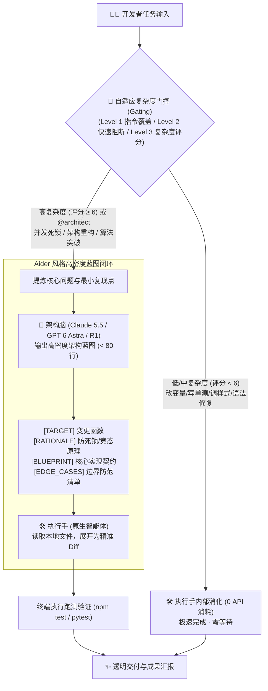
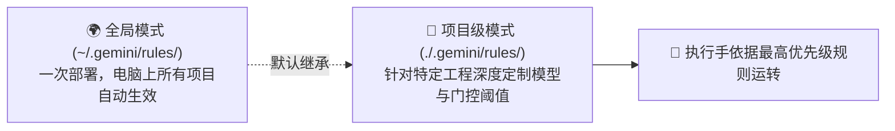

# 🌟 Twin-Engine Orchestration 2.0 (双星智能体协作)

<p align="center">
  <b>让推理旗舰（架构脑）与原生执行引擎（执行手）强强联合的 AI 辅助编程协同框架</b><br>
  <i>融入 Aider 蓝图压缩机制 + RouteLLM 自适应复杂度门控，大幅降低 API 成本与交互延迟</i>
</p>

<p align="center">
  
  
  
  
  
</p>

---

## 📌 核心痛点与 2.0 升级

传统单模型或暴力调用多模型普遍存在三大痛点：
1. **配额见底**：官方 Claude 5.5 / GPT-6 订阅额度耗尽（0% 配额），导致深度推演工作彻底停摆；
2. **杀鸡用牛刀**：改变量名、写单测等轻量任务也频繁触发高级模型，白白耗尽昂贵的中转 API 额度；
3. **大模型吐字慢与代码吞噬**：强迫顶级模型打印几百行完整代码，不仅等待 30+ 秒，还常因 `// ... existing code ...` 截断覆盖旧代码。

**Twin-Engine 2.0** 全面引入两大核心升级：
* ⚡ **Aider 风格“高密度蓝图 (Blueprint Protocol)”**：架构脑严格限制输出行数（< 80 行），仅输出核心逻辑与契约，由执行手在本地展开为严密精准 Diff；
* 🎯 **RouteLLM 风格“自适应复杂度门控 (Adaptive Gating)”**：建立三级分流流水线，70% 琐碎任务零费用内部解决，仅在评分 ≥ 6 分的高并发、死锁、复杂重构场景自动激活架构脑。

---

## 🎭 双星 2.0 协同全景架构



---

## 📊 优化前后实测收益对比

| 核心维度 | 优化前 | 2.0 优化后 (蓝图 + 门控) | 提升幅度 |
| :--- | :--- | :--- | :---: |
| **API Token 费用** | 无论大小任务全量收发代码 | 70% 琐碎任务零消耗；大任务仅发蓝图 | **费用直降 75% ~ 85%** |
| **单次响应耗时** | 架构脑吐出 400 行代码需等 30 秒 | 架构脑输出 50 行蓝图仅需 4 秒，本地毫秒级打补丁 | **速度提升 3 ~ 4 倍** |
| **代码完整性** | 常因模型截断丢失上下文 | 架构脑只定契约，执行手本地做严密精准 Diff | **彻底消除代码吞食** |
| **配额有效续航** | 几轮对话就把 API Key 消耗殆尽 | 门控严防死守，把高价值算力全部留给核心难点 | **续航延长 5 倍以上** |

---

## 📂 项目结构

```text
twin-engine-orchestration/
├── .gemini/
│   └── rules/
│       └── twin-engine.md            # Antigravity 工作区双星 2.0 规则
├── docs/
│   ├── setup-architect-brain.md      # 架构脑大模型单独设置全指南
│   └── deployment-guide.md           # 全局配置 vs 项目级配置完整方案
├── scripts/
│   ├── install.ps1                   # Windows PowerShell 一键部署脚本
│   └── install.sh                    # macOS / Linux Bash 一键部署脚本
├── rules/
│   ├── twin-engine.md                # 跨平台双星 2.0 规范定义
│   ├── routing-policy.md             # 自适应复杂度路由与门控策略 (详细打分矩阵)
│   ├── AGENTS.md                     # 全局智能体行为规范
│   ├── cursor-rule.mdc               # Cursor 专用规则模板
│   └── cline-system-prompt.md        # Claude Code / Cline 系统提示词模板
├── skills/
│   └── twin-engine/
│       └── SKILL.md                  # Antigravity Skill 标准技能定义
├── config/
│   ├── mcp-config.example.json       # MCP 服务配置示例
│   └── models.example.json           # 架构脑中转模型配置模板
├── templates/
│   └── architect-prompt-templates.md # Blueprint Protocol 输出契约与提炼模板
├── examples/
│   ├── sample-workflow.md            # 支付状态机重构实战全流程
│   └── blueprint-optimization.md     # 蓝图压缩与门控实测案例对比
├── LICENSE                           # MIT 开源许可证
└── README.md                         # 项目主说明文档
```

---

## 🧠 如何设置架构脑大模型 (Architect Brain Setup)

“架构脑”是双星协同中的顶层思考中枢（推荐选用 **Claude 5.5 Sonnet/Opus**、**GPT 6 Astra** 或 **DeepSeek R1**）。框架支持以下配置方式：

### 1. 对话一句话极速配置（最推荐）
直接在任意对话框中将中转站的 API 信息发送给智能体：
> *“帮我配置一个架构脑模型：*  
> *名称：`Claude 5.5 Sonnet`*  
> *BaseURL：`https://api.your-relay.com/v1`*  
> *API Key：`sk-xxxxxxxx`*  
> *Model ID：`claude-sonnet-5-5`，并设为默认激活。”*

智能体将自动调用 MCP 完成密钥安全存储、协议握手与连通性测速。

### 2. 搭配图形面板可视化配置
搭配配套生态项目 [**Antigravity API Manager**](https://github.com/garydak/antigravity-api-manager)，直接在编辑器侧边栏面板中填写 BaseURL 与 API Key，一键测试网络延迟（ms）并切换默认模型。

### 3. 日常调用与随时切换
* **全局默认激活**：日常高复杂度任务会自动交由当前默认架构脑推演；
* **单次动态指定**：无需改配置，在提问时带模型 ID 即可，如 `@architect [claude-sonnet-5-5] 请重构状态机` 或 `@architect [gpt-6-astra] 请优化图算法`。

📖 **详细参数定义与排错指南**：[docs/setup-architect-brain.md](docs/setup-architect-brain.md)

---

## 🌍 全局配置 vs 📁 项目级配置方案 (Deployment Modes)

根据使用场景，框架支持**全局生效**与**具体单项目定制**两种部署模式：



### 1. 全局配置（所有项目开箱即用）
* **原理**：将规则部署到操作系统用户目录（`~/.gemini/rules/twin-engine.md`）；
* **效果**：无论在电脑哪个目录下启动 Antigravity，智能体均自动遵循双星 2.0 规则、自适应门控与蓝图输出；
* **一键安装**：
  ```powershell
  # Windows PowerShell
  .\scripts\install.ps1 -Mode global
  
  # macOS / Linux Bash
  ./scripts/install.sh global
  ```

### 2. 具体项目级配置（单工程隔离与定制）
* **原理**：将规则放置在具体工程根目录下的 `.gemini/rules/twin-engine.md`；
* **优势**：
  * **可提交进 Git**：全团队成员拉取代码后自动共享同一套双星架构规范；
  * **个性化定制**：可为该工程强制绑定特定的架构脑模型（如仅允许 `claude-opus-5-5`），或微调门控激活阈值（如金融核心调至 ≥ 4 分，轻微疑难即唤醒架构脑）；
* **一键应用到当前项目**：
  ```powershell
  # Windows PowerShell (在你的工程根目录执行)
  path\to\twin-engine-orchestration\scripts\install.ps1 -Mode project

  # macOS / Linux Bash
  path/to/twin-engine-orchestration/scripts/install.sh project
  ```

### 3. 优先级仲裁机制
1. **P0 (最高)**：对话框单次指令 `@architect [model-id]` 覆盖一切；
2. **P1 (次高)**：当前工程根目录 `.gemini/rules/` 项目级规则；
3. **P2 (基础)**：全局用户目录 `~/.gemini/rules/` 全局环境规则。

📖 **详细多 IDE 部署指南**：[docs/deployment-guide.md](docs/deployment-guide.md)

---

## 🚀 如何使用？

使用双星协同 2.0 极其自然，**你只需要正常编写代码或提需求，系统会自动分流**：

### 1. 日常轻量开发（全自动零成本）
直接对智能体说：
> *“帮我给 UserDTO 添加一个 avatarUrl 字段，并在 user.test.ts 中补齐 mock。”*  
> *“修复这个 TypeError: undefined is not an object 报错。”*

* **系统行为**：门控系统自动识别为 **Level 2 简单任务**，直接由原生执行手在本地秒级搞定，**不会调用中转 API，完全零花费**。

---

### 2. 深度架构/疑难攻坚（显式指派架构脑）
当你遇到已知的高难度设计时，加上 `@architect`：
> *“@architect 请帮我重构这里的支付状态机，防范分布式并发扣款竞态，并在本地完成测试。”*  
> *“@architect [claude-sonnet-5-5] 请针对这道图算法的递归堆栈溢出问题，给出基于 BFS + 拓扑排序的优化蓝图。”*

* **系统行为**：强制唤醒架构脑，架构脑以极少 Token 快速返回 `< 80 行` 高密度蓝图，原生执行手自动将其展开为代码 Diff 并跑测。

---

### 3. 复杂场景自动激活（隐式雷达唤醒）
无需输入任何特殊符号，只需描述你的技术挑战：
> *“我们的微服务在并发压测到 500 QPS 时偶发死锁，查看日志疑似两段事务交叉加锁导致，请彻底排查。”*

* **系统行为**：门控系统在“并发与状态”维度命中 +4 分，在“排错深度”维度命中 +3 分，总分 7 分（≥ 6 分阈值），**自动唤醒架构脑协同推演**并交付。

---

## 🛠️ 接入指南

1. **Antigravity / Gemini CLI**：
   直接将本项目 `.gemini/rules/twin-engine.md` 拷贝到你的工作区根目录下；
2. **Cursor**：
   将 `rules/cursor-rule.mdc` 放置到工作区 `.cursor/rules/twin-engine.mdc`；
3. **Claude Code / Cline**：
   将 `rules/cline-system-prompt.md` 追加到 Custom Instructions。

---

## 💎 黄金搭档推荐 (Recommended Companion)

> [!TIP]
> **在 Google Antigravity 中搭配运行最佳体验**：  
> 强烈推荐搭配配套生态项目 [**Antigravity API Manager**](https://github.com/garydak/antigravity-api-manager) 一同使用！  
> 
> * **无缝协同**：`antigravity-api-manager` 专为 Antigravity 设计，提供第三方 API / 中转站模型的高效调度、多账号热切换与原生侧边栏可视化面板；
> * **即装即用**：安装后可直接在 Antigravity 界面内对“架构脑”模型（如 Claude 5.5 Sonnet、GPT 6 Astra）进行可视化测速、Token 额度监控与热切换，无需手动折腾底层配置文件，实现双星协同的最佳开发体验！

---

## 📄 License

本项目采用 [MIT License](LICENSE) 开源协议。
