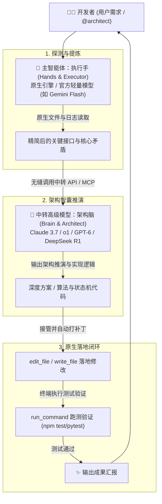

# 🌟 Twin-Engine Orchestration (双星智能体协作)

<p align="center">
  <b>让推理旗舰（架构脑）与原生执行引擎（执行手）强强联合的 AI 辅助编程协同框架</b>
</p>

<p align="center">
  
  
  
  
  
</p>

---

## 📌 诞生背景与核心痛点

在日常使用现代 AI 编程辅助工具（如 Google Antigravity、Cursor、Claude Code 等）时，开发者普遍面临两大核心瓶颈：

1. **官方旗舰模型配额壁垒**：官方订阅的高级模型（如 Claude 3.7 / GPT-4o / o1）每周配额迅速见底（经常触发 `0%` 限制），导致高阶推理中断。
2. **能力与权限的错位**：
   - **外挂中转高级模型**：推理深度极强，但在纯 Web 端或独立 API 中缺少直接读写本地文件、执行终端测试的原生系统权限；
   - **本地原生代理智能体**：拥有全套本地工具（读写文件、终端命令、浏览器调试），但使用轻量模型时在深层架构推演与复杂算法设计上容易遇到瓶颈。

**Twin-Engine Orchestration (双星智能体协作)** 应运而生 —— 将系统拆分为**“架构脑 (Brain)”**与**“执行手 (Hands)”**，在同一个上下文会话中分工协作、优势互补，达成全自动解决复杂任务的闭环。

---

## 🎭 核心角色划分 (Brain & Hands)



| 角色 | 主体 | 专长与职责 | 系统权限 |
| :--- | :--- | :--- | :--- |
| **🧠 架构总师与深度智囊<br>(Brain & Architect)** | 第三方中转高级模型<br>*(Claude 3.7 / o1 / DeepSeek R1 / GPT-6)* | 顶层架构设计、并发竞态诊断、复杂算法逻辑推演、安全审计与代码终审 | 纯思考 / 无状态推理 |
| **🛠️ 执行工程师与全局管家<br>(Hands & Executor)** | 本地会话主智能体<br>*(Gemini 3.8 Flash / 原生引擎)* | 全局代码扫描、文件修改（Diff）、终端命令执行、本地测试与环境验证 | **系统级原生工具集**<br>`read_file`, `edit_file`, `run_command` 等 |

---

## ✨ 核心优势

1. **🚀 零额度焦虑 (Zero-Quota-Anxiety)**
   - 官方高级订阅有额度时：尽情使用；
   - 官方高级配额耗尽（0%）后：主智能体切为无限量/轻量模型充当“手”，架构推演交给中转高级模型充当“脑”，工作流永不中断。
2. **🔄 同会话无缝闭环 (No Copy-Paste)**
   - 彻底告别“在网页端向顶级模型提问，再手动复制到本地 IDE 粘贴修改”的繁琐流程；
   - 原生智能体自动向中转模型请教，并自动接管方案在本地落盘、运行测试。
3. **🎯 架构脑随心选 (Flexible Brain Selection)**
   - 支持自由配置多种中转模型，单次提问可随时指定（例如：重度推演选 `o1`，工程重构选 `Claude 3.7 Sonnet`）。
4. **🛡️ 验证前置保障质量**
   - 架构脑输出的代码方案必须经过本地执行手跑测验证，严防臆造代码与语法退化。

---

## 📂 项目结构

```text
twin-engine-orchestration/
├── .gemini/
│   └── rules/
│       └── twin-engine.md            # Antigravity 项目级双星协同规则
├── rules/
│   ├── twin-engine.md                # 跨平台通用双星协同规则
│   ├── AGENTS.md                     # 全局智能体行为规范
│   ├── cursor-rule.mdc               # Cursor 专用规则模板
│   └── cline-system-prompt.md        # Claude Code / Cline 系统提示词模板
├── skills/
│   └── twin-engine/
│       └── SKILL.md                  # Antigravity Skill 标准技能定义
├── config/
│   ├── mcp-config.example.json       # MCP 服务配置示例
│   └── models.example.json           # 架构脑中转模型配置模板
├── templates/
│   └── architect-prompt-templates.md # 架构脑提炼提问结构化模板
├── examples/
│   └── sample-workflow.md            # 支付状态机重构实战全流程示例
├── LICENSE                           # MIT 开源许可证
└── README.md                         # 项目主说明文档
```

---

## 🚀 快速上手

### 1. 接入规则

#### 方式 A：在 Antigravity 中使用
将本项目中的 `.gemini/rules/twin-engine.md` 拷贝到你的工作区根目录下，主智能体将自动识别并遵守双星协同规则。

#### 方式 B：在 Cursor 中使用
将 `rules/cursor-rule.mdc` 放置在项目根目录 `.cursor/rules/twin-engine.mdc` 中。

#### 方式 C：在 Claude Code / Cline / Roo Code 中使用
将 `rules/cline-system-prompt.md` 内容复制并追加到扩展设置中的 **Custom Instructions**。

---

### 2. 配置架构脑（中转 API / MCP）

1. **准备中转 API Key 与模型**（支持 OpenAI 规范与 Anthropic 规范接口，如 MoreMark AI、OpenRouter、DeepSeek 等）。
2. 在 `config/models.example.json` 中配置你的架构模型池：
   ```json
   [
     {
       "id": "mdl_claude_37_sonnet",
       "name": "Claude 3.7 Sonnet (Thinking)",
       "modelId": "claude-3-7-sonnet-20250219",
       "baseUrl": "https://api.your-relay.com/v1",
       "protocol": "openai"
     }
   ]
   ```
3. 挂载 `api-model-switcher-mcp` 服务即可实现 Agent 内工具化调度。

---

### 3. 日常唤醒与使用

#### 场景 1：指令唤醒（明确指派架构脑）
在对话中加入 `@architect` 或指定模型名称：
> *“@architect 请帮我重新设计分布式订单幂等状态机，重点排查高并发下的漏单问题，并直接修改代码测试。”*

#### 场景 2：指定特定推理模型
> *“@architect [o1] 请帮我推演图算法中的拓扑排序并提供优化实现。”*

#### 场景 3：疑难死锁自动激活
当本地主智能体在排查深层并发竞态、死锁、复杂状态同步且无法根治时，将依照规则自动发起双星协同，向架构脑求取推演方案。

---

## 🛠️ 实战示例 (Sample Walkthrough)

查看 [examples/sample-workflow.md](examples/sample-workflow.md) 了解真实的支付并发去重全流程：
1. 主智能体提炼 `order-service.ts` 关键时序差；
2. 架构脑推演 CAS 乐观锁与分布式锁策略；
3. 主智能体调用 `edit_file` 原生修改；
4. 主智能体调用 `run_command` 运行 1000 组并发压测并成功交付。

---

## 🤝 贡献与反馈

欢迎提交 PR 或 Issue 为双星协同补充更多 IDE（如 Windsurf、Trae、Aider）适配规则与高效提炼模板！

## 📄 License

本项目采用 [MIT License](LICENSE) 开源协议。
