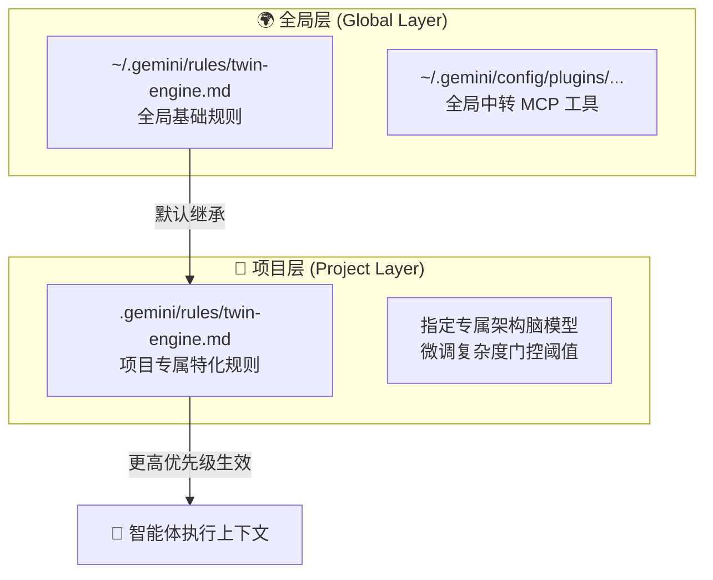

# 双星协同部署指南：全局配置 vs 项目级配置 (Deployment Guide)

本文档指导开发者如何将 **Twin-Engine Orchestration (双星智能体协作)** 部署到全局开发环境（所有工程通用）或特定单体项目中（深度定制隔离）。

---

## 方案总览：双层继承与生效机制



---

## 一、方案 A：配置到全局（所有项目开箱即用）

### 适用场景
* 希望电脑上的每一个新建目录、老工程、临时脚本都能直接使用双星协同；
* 追求零配置，打开任何工程即可输入 `@architect` 或享受自动复杂度分流。

### 部署步骤

#### 1. 将规则写入全局用户目录
将本项目的 `rules/twin-engine.md` 拷贝到操作系统的 Antigravity 全局规则目录：
* **Windows**：`C:\Users\<你的用户名>\.gemini\rules\twin-engine.md`
* **macOS / Linux**：`~/.gemini/rules/twin-engine.md`

#### 2. 全局 MCP 工具注册
配合 [**Antigravity API Manager**](https://github.com/garydak/antigravity-api-manager)，其内置的 MCP Server 会常驻后台，为全系统提供 `chat_with_custom_model` 工具。

#### 3. 验证全局生效
在电脑任意空白文件夹内启动 Antigravity，向智能体提问：
> *“@architect 请确认当前架构脑工作状态”*  
如果智能体成功唤醒外部架构脑并输出蓝图，则表明全局部署完成。

---

## 二、方案 B：配置到具体项目中（项目级隔离与定制）

### 适用场景
* 团队协同协作代码库，希望将规范随代码一同 Git 提交给全组共享；
* 核心关键业务，需要针对性微调门控阈值（例如支付系统需要更严格的架构把关）；
* 该项目限定使用特定厂商的架构模型（如仅允许使用私有部署的 DeepSeek R1）。

### 部署步骤

#### 1. 初始化项目规则目录
在你的项目根目录下创建 `.gemini/rules/` 目录：
```bash
# 进入你的项目根目录
mkdir -p .gemini/rules
```

#### 2. 复制规则文件到项目内
将 `rules/twin-engine.md` 拷贝为 `.gemini/rules/twin-engine.md`。

#### 3. （可选）在项目规则中定制参数
直接编辑 `.gemini/rules/twin-engine.md` 头部，按需定制：

```markdown
# 本项目专属架构配置：
1. 专属架构脑：强制指定使用 `claude-opus-5-5` 进行所有复杂设计；
2. 门控阈值定制：本项目为金融账务核心模块，复杂度激活阈值调整为 ≥ 4 分（轻微风险即唤醒架构脑）；
3. 架构禁忌：严禁在 Controller 层直接书写事务性 SQL 逻辑。
```

---

## 三、配置优先级仲裁机制 (Priority Resolution)

当多处配置同时存在时，系统按以下严格优先级执行：

| 优先级 | 生效来源 | 适用场景 | 示例 |
| :---: | :--- | :--- | :--- |
| **P0 (最高)** | **对话动态指令** | 开发者单次指定，覆盖一切 | `@architect [gpt-6-astra] ...` |
| **P1 (次高)** | **项目级规则** | 当前项目根目录 `.gemini/rules/` | 项目指定的专属模型与门控分值 |
| **P2 (基础)** | **全局环境规则** | `~/.gemini/rules/` | 默认通用分流逻辑与蓝图输出契约 |

---

## 四、跨 IDE 适配方案

| 开发环境 | 全局配置位置 | 单项目配置位置 |
| :--- | :--- | :--- |
| **Google Antigravity** | `~/.gemini/rules/twin-engine.md` | `<project>/.gemini/rules/twin-engine.md` |
| **Cursor IDE** | Settings -> General -> Rules for AI | `<project>/.cursor/rules/twin-engine.mdc` |
| **Claude Code / Cline** | Extension Settings -> Custom Instructions | `<project>/.clinerules` |
