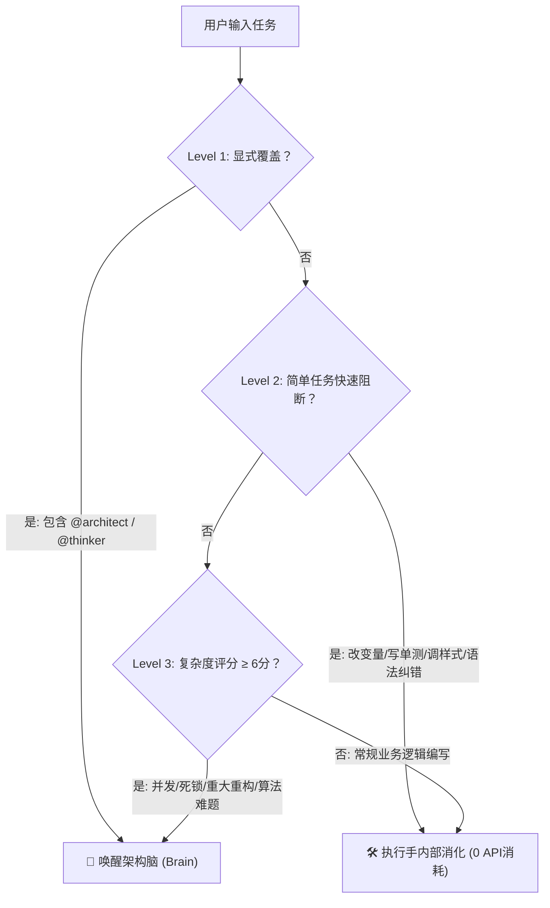

# 自适应复杂度路由与门控策略 (Adaptive Routing Policy)

本策略规定了“双星智能体协同 (Twin-Engine)”在接收到任务时，如何自适应判断是由本地**执行手 (Hands)** 内部消化，还是唤醒外部**架构脑 (Brain)**。

---

## 一、三级路由流水线 (Three-Tier Routing Pipeline)

---

## 二、Level 1：显式覆盖 (Explicit Override)
当用户输入中包含以下指令时，**无视复杂度评分，强制唤醒架构脑**：
* 包含 `@architect`、`@thinker` 前缀；
* 明确指示：“向架构脑请教”、“请 Claude/o1 推演方案”、“执行双星协同”。

---

## 三、Level 2：简单任务快速阻断 (Direct Hands-off)
命中以下特征之一的任务，**强制由本地执行手（免费/无限量原生模型）直接解决，严禁调用中转模型**：
1. **重命名与简单提取**：变量名修改、函数提取、TypeScript 类型轻度补齐；
2. **测试与数据构建**：根据现有逻辑补写常规单测用例、编写 Mock JSON 数据；
3. **确定性报错修复**：具备明确行号与原因的语法错误、空指针、拼写错误、路径引用错误；
4. **前端样式微调**：CSS 间距、颜色调整、Flex/Grid 布局简单适配；
5. **文档与注释**：生成 JSDoc、撰写 README 段落、整理 Git Commit Message。

---

## 四、Level 3：复杂度特征雷达打分表 (Scoring Matrix)

对于非显式覆盖且未被 Level 2 阻断的任务，执行手根据以下特征打分（总分 10 分）：

| 维度 | 命中特征 | 分值 |
| :--- | :--- | :---: |
| **并发与状态** | 涉及高并发压测、竞态条件 (Race Condition)、死锁 (Deadlock)、分布式锁、复杂状态机转移 | **+4 分** |
| **架构与解耦** | 跨 3 个以上模块的核心解耦、破坏性重构、领域驱动模型重新划分 | **+3 分** |
| **算法与性能** | 涉及图遍历、动态规划、大量数据处理瓶颈、计算时间/空间复杂度超标 | **+3 分** |
| **排错连续挫败** | 执行手在当前会话已连续尝试 2 次修复同一 Bug 但单测依旧未通过 | **+3 分** |
| **安全与资产** | 涉及支付状态变更、防重放攻击、SQL/命令注入审计、鉴权令牌生命周期 | **+3 分** |

* **得分 < 6 分**：由执行手快速完成；
* **得分 ≥ 6 分**：执行手自动发起双星协同，向架构脑提交高密度咨询蓝图。
